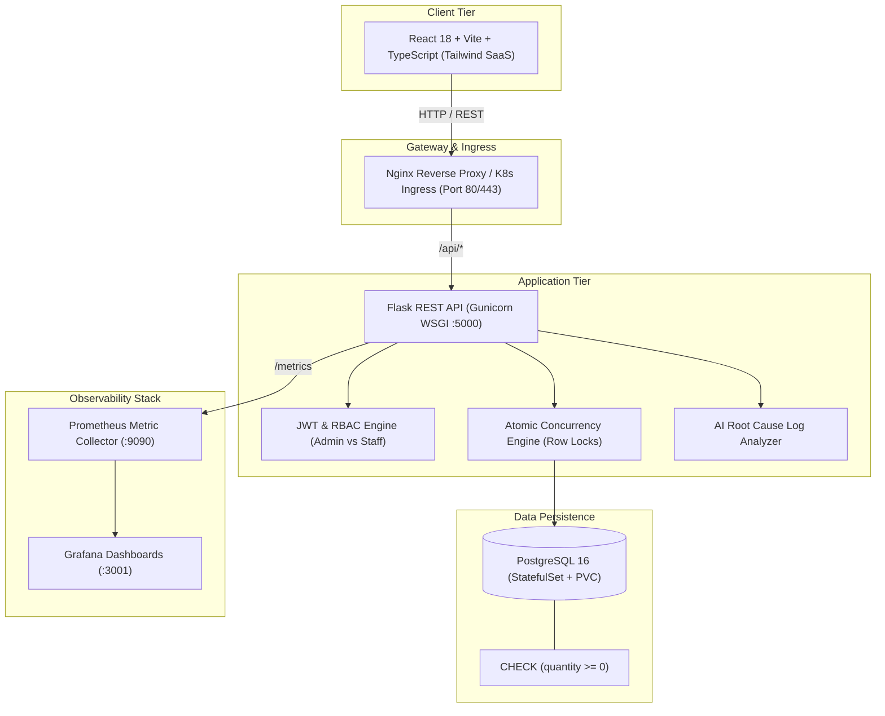

# SmartStock — Smart Inventory Management & DevOps Automation Platform

[](jenkins/Jenkinsfile)
[](kubernetes/)
[](argocd/)
[](backend/tests/)
[](sonar-project.properties)
[](https://github.com/shubham055555/SmartStock)
[](https://shubham055555.github.io/SmartStock/)

> 🌐 **Live Interactive Application**: **[https://shubham055555.github.io/SmartStock/](https://shubham055555.github.io/SmartStock/)**  
> Explore the live dashboard, product inventory, atomic stock movements, and the AI DevOps diagnostic center directly in your browser. Use the **1-Click Demo Fill** buttons on the login screen to authenticate instantly!

---

## 📌 Executive Summary

**SmartStock** is a production-grade, distributed inventory management platform and cloud-native DevOps automation system. 

Engineered for high availability, transactional consistency, and continuous cloud delivery, SmartStock demonstrates both a fully functioning transactional business system and an enterprise DevOps lifecycle:
- **Application Engine**: Python Flask modular architecture, PostgreSQL relational schema, JWT authentication, backend-enforced RBAC, atomic concurrency control, and negative inventory prevention.
- **Modern User Experience**: React 18, Vite, TypeScript, and Tailwind CSS SaaS dashboard with Recharts visualizations, CSV reports, low-stock alerts, and 1-click evaluation credentials.
- **DevOps Lifecycle**: Multi-stage Docker containers, Declarative Jenkins CI/CD, Kubernetes orchestration with HPA, zero-downtime Blue-Green deployments, ArgoCD GitOps, Terraform IaC, Ansible automation, Prometheus/Grafana monitoring, and an AI-powered root cause log analysis engine.

---

## 🏛️ System Architecture



---

## 🚀 Quick Start Guide

### Option 1: Run Full Stack via Docker Compose (Recommended)

To launch the complete environment (PostgreSQL, Backend API, Frontend SPA, Prometheus, and Grafana) in an isolated container network:

```bash
# 1. Copy sample environment file
cp .env.example .env

# 2. Build and start all services
docker compose up -d --build

# 3. Verify container health status
docker compose ps
```

**Service URLs:**
- **Frontend Dashboard**: [http://localhost:3000](http://localhost:3000) (or port 80 via Ingress)
- **Backend API**: [http://localhost:5000/api](http://localhost:5000/api)
- **Liveness Probe**: [http://localhost:5000/healthz](http://localhost:5000/healthz)
- **Readiness Probe**: [http://localhost:5000/ready](http://localhost:5000/ready)
- **Prometheus Metrics**: [http://localhost:5000/metrics](http://localhost:5000/metrics)
- **Prometheus Server**: [http://localhost:9090](http://localhost:9090)
- **Grafana Dashboards**: [http://localhost:3001](http://localhost:3001) (`admin` / `admin`)

---

### Option 2: Local Development Setup (Without Docker)

#### 1. Backend Setup:
```bash
cd backend
python -m venv .venv

# On Windows PowerShell:
.venv\Scripts\Activate.ps1
# On Linux/macOS:
source .venv/bin/activate

pip install -r requirements.txt
pip install -r requirements-dev.txt

# Run initial schema creation and rich catalog seed
python seed.py

# Launch development server on http://localhost:5000
python run.py
```

#### 2. Frontend Setup:
```bash
cd frontend
npm install
npm run dev
# Accessible on http://localhost:5173
```

---

## 🔑 Academic Evaluation Credentials

For rapid grading and viva demonstrations, the login screen provides **1-click credential buttons**:

| Role | Username | Password | Access Capabilities |
|---|---|---|---|
| **Administrator** | `admin` | `Admin@123` | Full CRUD, SKU deletion, supplier/category creation, stock ops |
| **Warehouse Staff** | `staff` | `Staff@123` | Stock IN, Stock OUT, ledger viewing, CSV export (Deletion blocked) |

---

## 🧪 Testing & Verification

SmartStock includes automated unit and integration tests across backend and frontend:

```bash
# Backend Pytest Suite with Statement Coverage
cd backend
.venv\Scripts\pytest -v --cov=app --cov-report=term-missing
# Result: 17 Passed, 79% Statement Coverage

# Frontend Vitest Suite
cd frontend
npm run test
# Result: All UI component and badge tests pass

# Frontend Production Build
cd frontend
npm run build
# Result: Clean TypeScript compilation and Vite chunk bundling
```

---

## 📂 Repository Directory Layout

```
smartstock/
├── backend/                  # Python Flask REST API
│   ├── app/                  # Application factory, Blueprints, Models, Services
│   ├── tests/                # Pytest unit & integration test suite
│   ├── seed.py               # Database seeder with realistic inventory SKUs
│   ├── run.py / wsgi.py      # Entrypoints for local dev & production Gunicorn
│   └── requirements.txt      # Python dependencies
├── frontend/                 # React 18, Vite, TypeScript & Tailwind CSS
│   ├── src/                  # Components, Contexts, Pages, Services, Types
│   ├── package.json          # Node dependencies & build scripts
│   └── vite.config.ts        # Vite configuration & Vitest test runner
├── database/                 # PostgreSQL relational DDL schema (init.sql)
├── docker/                   # Multi-stage Dockerfiles & Nginx configurations
├── jenkins/                  # Jenkinsfile declarative CI/CD multi-stage pipeline
├── kubernetes/               # Kubernetes manifests (StatefulSet, HPA, Ingress)
│   └── blue-green/           # Blue-Green zero-downtime manifests & switch script
├── argocd/                   # ArgoCD Application CRD & GitOps kustomization
├── terraform/                # Infrastructure as Code (VPC, EKS, RDS PostgreSQL)
├── ansible/                  # Idempotent playbooks for host, Docker, K8s prereqs
├── monitoring/               # Prometheus scrape config & Grafana dashboards
├── logging/                  # ELK Stack configuration & Logstash pipeline
├── docs/                     # Capstone Deliverables
│   ├── ARCHITECTURE.md       # High-level architecture & Mermaid diagrams
│   ├── PROJECT_REPORT_OUTLINE.md # 20-Page Capstone project report structure
│   ├── TEAM_TASK_DIVISION.md # Task distribution for 2 students
│   ├── DEMO_SCRIPT.md        # 10-Minute viva presentation script
│   └── API_DOCUMENTATION.md  # Complete REST API specification
├── docker-compose.yml        # Multi-container orchestration
├── sonar-project.properties  # SonarQube code quality configuration
└── DEVELOPMENT_STATUS.md     # Task tracking register
```

---

## 🛡️ DevOps & Reliability Engineering Highlights

1. **Negative Inventory Prevention**: Dual-layer protection using PostgreSQL row locks (`with_for_update`) and table check constraints (`quantity >= 0`). Attempts to dispense more than available stock immediately return `400 Insufficient Stock` and roll back transactions.
2. **Zero-Downtime Blue-Green Deployment**: Documented scripts (`kubernetes/blue-green/switch-traffic.sh`) switch traffic between blue and green deployments with zero connection drops.
3. **Bonus AI Log Diagnostics**: Live studio (`/devops`) that sanitizes stack traces, classifies root causes (Postgres socket loss, OOMKilled, JWT expiration, unique constraints), and outputs copy-ready remediation commands.
4. **GitOps with ArgoCD**: Git-driven state synchronization with automated self-healing.
5. **Observability**: Prometheus histograms, custom inventory gauges, and pre-configured Grafana dashboards.

---

## 👥 Engineering Team & Component Ownership

- **Student 1 (Backend & Cloud Infrastructure)**: Flask REST architecture, PostgreSQL relational schema, concurrency control, Kubernetes manifests, Blue-Green deployment, Terraform, and Ansible.
- **Student 2 (Frontend, CI/CD & Observability)**: React TypeScript SaaS UI, Tailwind design system, Jenkinsfile pipeline, ArgoCD GitOps, Prometheus/Grafana monitoring, and Bonus AI Log Analyzer.

*See detailed division and marks breakdown in [docs/TEAM_TASK_DIVISION.md](docs/TEAM_TASK_DIVISION.md).*
