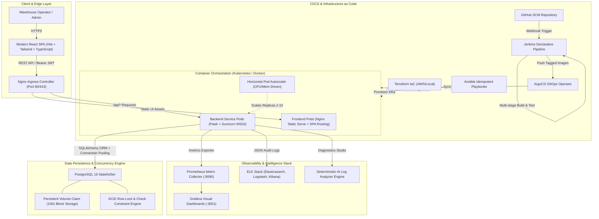

# SmartStock System Architecture & DevOps Engineering Specification

## 1. High-Level Architectural Blueprint

SmartStock is architected as a cloud-native, distributed inventory management and reliability platform. It features strict transactional consistency, role-based security boundaries, automated CI/CD pipelines, container orchestration, GitOps synchronization, and automated root cause log intelligence.

---

## 2. Core Subsystem Breakdown

### 2.1 Concurrency Control & Negative Stock Prevention
In high-throughput inventory facilities, race conditions occur when multiple staff members simultaneously fulfill purchase orders for the same SKU. SmartStock resolves this at two distinct layers:
1. **Application Level**: `db.session.with_for_update()` explicitly locks targeted product rows during active Stock IN / Stock OUT transactions within an isolated transaction boundary.
2. **Database Level**: PostgreSQL relational table check constraints enforce `CONSTRAINT check_positive_stock CHECK (quantity >= 0)`. Any attempt to execute an over-dispense operation raises an immediate `InsufficientStockError` and rolls back all nested changes.

### 2.2 Blue-Green Deployment Strategy
Zero-downtime updates are coordinated via two active deployment tiers:
- `smartstock-backend-blue` (Active v1.0.0)
- `smartstock-backend-green` (Staged v1.1.0)
- `smartstock-backend-live` Service points its `selector: { version: blue }`.
- When tests pass on Green, `./switch-traffic.sh green` instantly patches the Service selector with zero dropped TCP connections.

### 2.3 Prometheus & Grafana Monitoring Architecture
The backend registers custom instrumentation counters and gauges:
- `smartstock_http_requests_total{method, endpoint, status}`
- `smartstock_http_request_duration_seconds{method, endpoint}`
- `smartstock_inventory_items_total`
- `smartstock_inventory_units_total`
- `smartstock_inventory_value_usd`
Prometheus scrapes `/metrics` at 5-second intervals, visualized on Grafana dashboard panels.
